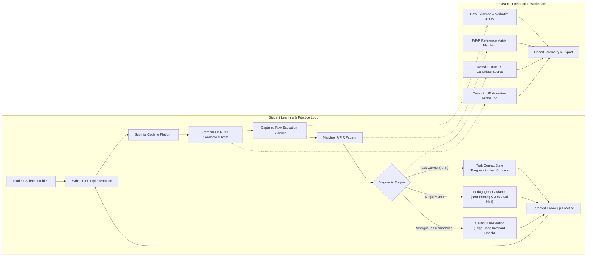
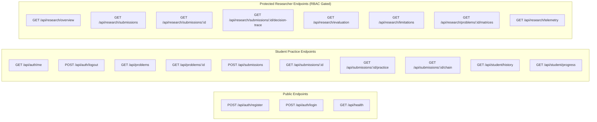
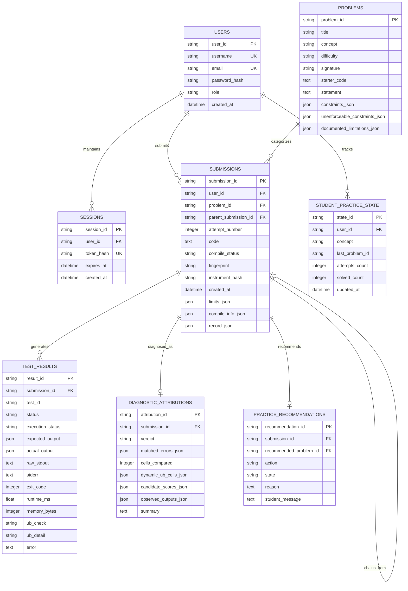

# CodeAdapt System Architecture & Product Design Specification

## 1. Executive Summary & Product Mission

**CodeAdapt** is an adaptive C++ coding-practice platform designed to investigate a core question in computer science education research: **can a student's code-execution behavior provide reliable evidence of programming misconceptions to guide targeted follow-up practice?**

Unlike traditional competitive programming platforms or automated grading systems that reduce submissions to an opaque score or percentage, CodeAdapt treats code execution as an **empirical measurement instrument**. Every submission compiles once and executes each test case in an independent, resource-bounded sandboxed process. The platform records raw, unreduced execution evidence—exit codes, CPU and wall-clock times, peak memory, raw standard output, remapped compiler diagnostics, and dynamic undefined behavior (UB) assertions.

The platform provides two purpose-built, role-gated environments:
1. **The Student Learning & Practice Area:** A distraction-free, pedagogically guided environment where students practice fundamental C++ concepts (Arrays, Linked Lists, Stacks, Queues, Binary Search), receive transparent execution evidence, and get targeted, non-priming practice follow-ups.
2. **The Researcher Inspection Workspace:** A high-fidelity research environment where CS education researchers and instructors inspect raw execution traces, examine diagnostic decision trees, analyze undefined behavior assertion probes, and evaluate cohort-level error distributions without obscuring ambiguity or construct limitations.



---

## 2. Comprehensive Audit of Current Implementation

### 2.1 Codebase Component Analysis

| File / Component | Responsibility | Current Implementation State | Architectural Observations & Gaps |
|---|---|---|---|
| `backend/app.py` | HTTP API Surface | Thin FastAPI service exposing `/health`, `/problems`, `/submissions`, `/submissions/{id}`, `/submissions/{id}/diagnostics`, `/submissions/{id}/practice`, `/problems/{id}/fingerprints`. | Synchronous endpoint execution blocks worker threads; lacks authentication, user session handling, and role gating. Student and researcher endpoints live on the same unauthenticated surface. |
| `backend/executor.py` | Compilation & Process Execution | Compiles untrusted C++ via MinGW GCC, executes one process per test under Windows Job Objects, evaluates outputs, remaps compiler diagnostics, runs secondary `-D_GLIBCXX_ASSERTIONS` probe, and manages temp dir cleanup. | Well-engineered isolation and error classification. Cleanup of transient temp directories relies on in-memory pending sets; does not scan or sweep orphaned folders across process restarts. |
| `backend/winjob.py` | Windows Sandbox Primitives | Creates Windows Job Objects with `ActiveProcessLimit=1`, `ProcessMemoryLimit=256MB`, `KILL_ON_JOB_CLOSE`, and `DIE_ON_UNHANDLED_EXCEPTION`. Lowers process tokens to Low Integrity while suspended. | Race-free job assignment and token lowering. Successfully blocks writes outside the workdir and process spawning. Reads outside workdir remain permitted under Windows DACLs. |
| `backend/problems.py` | Problem Definitions & Drivers | Stores P1–P5 definitions, C++ input emitters, expected outputs, test roles, driver skeletons, constraints, and research metadata. | Strict separation between execution data and research metadata. P4/T8 and P5/T3 approved reconciliations correctly integrated. |
| `backend/diagnostics.py` | Diagnostic Attribution Engine | Compares full $P/F/R$ fingerprints against `REFERENCE` matrices; excludes static and dynamic UB cells; handles collisions; enforces abstention on unmodeled patterns. | Implements cautious diagnosis and abstention faithfully. Does not compare returned values; operates on $P/F/R$ outcomes. |
| `backend/store.py` | Raw Evidence Storage | SQLite database (`evidence.db`) storing full JSON record verbatim in `submissions` table, plus denormalized rows in `test_results`. | Durable and byte-identical round-tripping. Lacks user/session relationships, relational foreign keys, migration management, and multi-tenant scoping. |
| `backend/static/index.html` | Frontend User Interface | Single-file vanilla HTML/JS application with dark/light theme, problem selector, textarea editor, test results table, and practice recommendation display. | Functional no-build client for demonstrations. Lacks modern editor features (syntax highlighting, line numbers, autocomplete), user login, attempt history, and researcher workspace views. |
| `tests/synthetic.py` | Controlled Test Submissions | Controlled synthetic C++ implementations, claimed document fingerprints, derived baselines, and static UB declarations. | Authoritative test fixtures. P2 and P5 have verified code/pseudocode; P1 and P4 retain prose-derived synthetic implementations. |
| `tests/run_regression.py` | Test & Contract Harness | Validates infrastructure invariants, evidence integrity, fingerprint re-derivation, diagnostic engine, and practice contract. | Rigorous regression testing. Detects and reports documented research divergences without silencing them. |
| `tests/test_hardening.py` | Security & Isolation Probes | Probes process spawning, filesystem write/read isolation, recursion containment, memory exhaustion, concurrency (8 threads), and cleanup. | Empirical security validation. Concurrency passes; read outside workdir confirmed allowed; directory cleanup failure detected. |

### 2.2 Empirical Audit Findings & Baseline Verification

Direct execution of the verification suites on the host environment (MinGW-w64 GCC 16.1.0 UCRT, Windows 11) yielded the following recorded results:

#### Regression Suite (`python tests/run_regression.py`)
- **Infrastructure Invariants:** `ALL 23 CHECKS PASSED`.
  - Correct solutions for P1–P5 compile and produce all-`P` fingerprints.
  - Wrong answers classify strictly as `F` (never `R`).
  - Crashes classify strictly as `R` (`CRASHED` via `0xC0000409` or `0xC0000005`).
  - Infinite loops classify strictly as `R` (`TIMEOUT` after 3.0s).
  - Memory exhaustion is bounded under the 256 MB cap (peak observed: 184.4 MB).
  - Compilation errors produce dedicated status with zero test rows (never mapped to `F` or `R`).
  - Compiler error messages remapped from generated harness lines to student source line numbers.
- **Evidence Integrity:** `ALL PASS`. Raw fields (`test_id`, `expected`, `actual`, `runtime_ms`, `memory_bytes`, `exit_code`) verified. Deterministic re-runs verified. Static state contamination between tests eliminated.
- **Diagnostic Engine Contract:** `ALL PASS`. Verified task correctness vs mastery distinction, P2 B/C collision reported as `ambiguous`, UB cells excluded, compile error yielding no diagnostic claim, and novel return-$n$ bug colliding with E3 row flagged as a known limitation.
- **Practice Endpoint Contract:** `ALL PASS`. Correct submissions recommend next problem; ambiguous submissions recommend retry; compilation errors return compiler feedback.
- **Documented Research Divergences (3 rows — preserved, not auto-corrected):**
  1. `P3 / E2_no_underflow_check`: Document claimed `PPPFPPPP`; observed is `PPPRPPPP` (Cell T4: calling `st.top()` on empty stack crashes under GCC 16.1.0).
  2. `P5 / E2_loop_condition`: Document claimed `RRRRRRRR`; observed is `RRRFRRRR` (Cell T4: out-of-bounds read `arr[n]` returns wrong value instead of trapping).
  3. `P5 / E4_upper_mid`: Document claimed `PPRRRRPR`; observed is `PPRFRRPR` (Cell T4: out-of-bounds read `arr[n]` returns wrong value).
- **Dynamic Undefined Behavior Measurements:**
  - `P3 / E2`: Declared T4; measured T4 (`!this->empty()`).
  - `P5 / E2`: Declared T4, T7; measured T4, T7 (`__n < this->size()`).
  - `P5 / E4`: Declared T4, T8; measured T4, T8 (`__n < this->size()`).

#### Hardening Probes (`python tests/test_hardening.py`)
- **Process Spawning:** `BLOCKED` (ActiveProcessLimit=1 held; exit code `F`/`R`).
- **Filesystem Write Outside Workdir:** `BLOCKED` (Low-Integrity token prevents writes to user profile/Temp).
- **Filesystem Read Outside Workdir:** `ALLOWED` (**Known and accepted limitation**: integrity levels restrict write access, but read access is governed by DACLs where the child runs under the backend user identity).
- **Unbounded Recursion:** `CONTAINED` (Process terminated with `STACK_OVERFLOW 0xC00000FD`).
- **Memory Exhaustion:** `CONTAINED` (Process terminated under memory limit with `STACK_BUFFER_OVERRUN 0xC0000409`).
- **Concurrency (16 submissions across 8 threads):** `OK` (All parallel fingerprints matched serial baselines).
- **Temp Directory Cleanup:** `LEAK` (**Measured Finding**): 1 pre-existing `si_sub_*` directory was detected in `$env:TEMP` because previous `sweep()` logic only tracked in-memory process sets rather than scanning orphaned folders on startup.

---

## 3. Technology Stack & Operational Rationale

```
+---------------------------------------------------------------------------------------+
|                                    CodeAdapt Tech Stack                               |
+-------------------+-------------------------------------------------------------------+
| Component         | Technology Choice & Rationale                                     |
+-------------------+-------------------------------------------------------------------+
| Backend Core      | Python 3.10+ with FastAPI & Uvicorn. Lightweight, asynchronous,   |
|                   | native typing support, low overhead, and fast JSON serialization. |
+-------------------+-------------------------------------------------------------------+
| Sandboxed Engine  | Windows Job Objects + Low-Integrity Tokens (kernel32 & advapi32).  |
|                   | Enforces strict process, memory, lifetime, and write boundaries.  |
+-------------------+-------------------------------------------------------------------+
| Toolchain         | MinGW-w64 GCC 16.1.0 UCRT (64-bit, -std=c++17 -O1). Space-free     |
|                   | install path. Secondary -D_GLIBCXX_ASSERTIONS build for UB probe.  |
+-------------------+-------------------------------------------------------------------+
| Database          | SQLite with WAL mode & foreign keys. Zero external service burden,|
|                   | byte-identical JSON preservation, and ACID relational integrity.  |
+-------------------+-------------------------------------------------------------------+
| Authentication    | Salted PBKDF2-HMAC-SHA256 (600,000 iterations) + 256-bit secure  |
|                   | session tokens in HTTP-only, SameSite cookies. RBAC on backend.   |
+-------------------+-------------------------------------------------------------------+
| Frontend UI       | Modular Single Page Application (ES6 modules, CSS Custom Tokens,  |
|                   | responsive dual-pane layout, C++ editor, dark/light theme).       |
|                   | Zero build step required for instantaneous local startup.         |
+-------------------+-------------------------------------------------------------------+
```

### 3.1 Frontend Stack Rationale
- **Zero-Friction Local Execution:** Rather than introducing a heavy Node.js build pipeline that could fail in restricted environments, the frontend is built as a **clean, modular Single Page Application (SPA)** using modern web standards (ES6 modules, CSS Custom Properties, and responsive layout primitives).
- **Design System:** Custom CSS design system with explicit dark/light mode tokens (`[data-theme="dark"]` for Developer Workspace, `[data-theme="light"]` for Learning Interface), fluid typography, and consistent spacing.
- **Embedded C++ Editor:** Feature-complete editor with line numbers, C++ syntax highlighting, tab key indentation ($4$ spaces), bracket auto-closing, and reset shortcuts.
- **Client Routing & State:** Lightweight hash-based client router (`#/problems`, `#/history`, `#/research/dashboard`) paired with an in-memory reactive state manager that handles authentication status, problem drafts, active test runs, and researcher metrics.

### 3.2 Backend Stack Rationale
- **FastAPI & Uvicorn:** Provides high-performance async HTTP endpoints, automated OpenAPI documentation, and native dependency injection for authentication and role gating.
- **CPU & Process Bounded Concurrency:** Submissions are CPU- and process-bound. FastAPI executes non-async endpoints in a threadpool, and `executor._slots` enforces a concurrency semaphore (`MAX_CONCURRENT=4`) to prevent host saturation.

### 3.3 Database & Persistence Strategy
- **SQLite in WAL Mode (`PRAGMA journal_mode = WAL;`):** Provides excellent concurrent read performance while guaranteeing ACID write durability.
- **Relational Normalization with Verbatim Storage:** Normalized tables (`users`, `submissions`, `test_results`, `diagnostic_attributions`, `practice_recommendations`) enable fast indexed lookups and cohort filtering, while `submissions.record_json` stores the complete, unreduced execution record verbatim to ensure research reproducibility.

### 3.4 Local Execution Runbook
To run the platform locally on Windows:
1. Verify compiler at `C:\tools\winlibs-x86_64-posix-seh-gcc-16.1.0-mingw-w64ucrt-14.0.0-r4\mingw64\bin\g++.exe`.
2. Install Python dependencies: `pip install -r requirements.txt`.
3. Start the server using the verified process-scoped environment:
   ```powershell
   $tool = "C:\tools\winlibs-x86_64-posix-seh-gcc-16.1.0-mingw-w64ucrt-14.0.0-r4\mingw64\bin"
   $env:SI_GXX = Join-Path $tool "g++.exe"
   $env:PATH = "$tool;$env:PATH"
   python -m uvicorn app:app --port 8077 --app-dir backend --reload
   ```
4. Access the application in any modern browser at `http://localhost:8077`.

---

## 4. User Roles & Distinct User Experiences

### 4.1 Role Matrix & Capabilities

| Capability / Resource | Student Role | Researcher Role | Admin Role |
|---|---|---|---|
| Register / Login / Profile | Yes | Yes | Yes |
| Browse Problem Catalog & Statements | Yes | Yes | Yes |
| Submit C++ Code Solutions | Yes | Yes | Yes |
| View Remapped Compiler Feedback | Yes | Yes | Yes |
| View Per-Test Outcomes ($P/F/R$) & Timings | Yes | Yes | Yes |
| View Student-Safe Practice Recommendations | Yes | Yes | Yes |
| View Personal Submission History | Yes (Own only) | Yes (Own only) | Yes (All) |
| Access Researcher Workspace (`/research/*`) | **No (403 Forbidden)** | **Yes** | **Yes** |
| View Researcher Diagnostic Error Labels | **No (Cognitive Firewall)**| **Yes** | **Yes** |
| Inspect Full Generated C++ Driver Code | **No** | **Yes** | **Yes** |
| Inspect Verbatim Submissions Across Cohorts | **No** | **Yes** | **Yes** |
| View Dynamic Assertion Probe Traces | **No** | **Yes** | **Yes** |
| Access Cohort Telemetry & Data Export | **No** | **Yes** | **Yes** |

---

## 5. Major Pages & Interface Architecture

### 5.1 Student Practice Experience

1. **Landing & Onboarding (`#/`)**
   - Clean introduction to CodeAdapt's execution-grounded learning methodology.
   - Conceptual overview of the 5 pilot data structures.
   - Clear explanation of the $P/F/R$ outcome vocabulary.
2. **Authentication Portal (`#/login`, `#/register`)**
   - Registration and login with inline validation. Role selector allows toggling to Researcher for evaluation.
3. **Student Dashboard (`#/dashboard`)**
   - Progress counters based strictly on actual database records (Solved count, Submissions count).
   - Concept cards showing completion status.
   - Recent attempts list with instant "Resume Problem" shortcuts.
4. **Searchable Problem Library (`#/problems`)**
   - Real-time text search and concept filter pills (Arrays, Linked Lists, Stacks, Queues, Binary Search).
   - Status indicators (Solved, Attempted, Unsolved).
5. **C++ Coding Workspace (`#/problems/:id`)**
   - Responsive split-pane layout: problem statement, signature, constraints, and examples on the left; code editor and execution controls on the right.
   - Starter code pre-loaded.
   - One-click "Run Tests" action with live compilation and execution progress spinner.
6. **Execution Evidence Drawer**
   - Compact fingerprint bar with colored status badges (`P`, `F`, `R`).
   - Detailed per-test table showing test ID, role, pass/fail status, expected vs actual outputs, runtime (ms), and peak memory (KB).
   - Undefined behavior alert banner if libstdc++ precondition assertions fire.
   - Remapped compilation diagnostics if syntax errors occur.
7. **Pedagogical Practice Guidance Card**
   - Transparent, non-priming explanation of the diagnostic state:
     - `Task Correct`: passing all tests confirms task correctness on tested inputs; clarifies that pass does not prove specific method or asymptotic complexity.
     - `Insufficient Evidence`: provides invariant guidance without revealing researcher error labels.
     - `Compilation Error`: guides student on compiler diagnostics.
   - Actionable follow-up recommendation button (`Retry Problem` or `Practice Next Problem`).
8. **Attempt History & Chaining (`#/history`)**
   - Chronological timeline of all submissions.
   - Attempt chaining links related attempts together (`Attempt #1` $\rightarrow$ `Attempt #2`), allowing students to see their code revisions.
9. **Student Profile (`#/profile`)**
   - Account overview, role badge, theme toggle (`Dark Developer Workspace` vs `Light Learning Interface`), and secure logout.

### 5.2 Researcher Workspace Experience

1. **Researcher Telemetry Dashboard (`#/research/dashboard`)**
   - Global submission metrics, unique learner counts, compilation failure rates.
   - Diagnostic verdict distribution chart (`task_correct`, `single_match`, `ambiguous`, `unmodelled`, `no_execution_evidence`).
   - Active toolchain configuration badge (`SI_GXX`, `c++17`, `-O1`, instrument hash).
2. **Evidence Explorer (`#/research/evidence`)**
   - Multi-parameter filterable table: filter by problem ID, verdict, fingerprint string, student, or date range.
   - Quick preview of per-test rows and UB status.
3. **Diagnostic Decision Trace Inspector (`#/research/evidence/:id`)**
   - **Source vs Harness View:** Side-by-side comparison of verbatim student source code and full generated C++ driver code.
   - **Full Execution Matrix:** Per-test table with expected vs actual values, raw stdout, stderr, NTSTATUS exit code, integrity level, runtime, and memory.
   - **Attribution Decision Breakdown:** Candidate error scores, reference fingerprints, mismatched test IDs, and excluded UB cells.
   - **Dynamic UB Probe Log:** Raw libstdc++ precondition failure text.
   - **Output Value Discrimination Check:** Differentiates identical $P/F/R$ fingerprints via actual returned output values (e.g., separating P5/E3 from novel return-$n$ bug).
   - **Raw Evidence Export:** Direct download of the verbatim record as JSON.
4. **Problem Benchmark & Matrix Viewer (`#/research/matrices`)**
   - Side-by-side comparison of Document Claimed Fingerprints vs Empirically Derived Baseline Fingerprints vs Student Observed Frequencies.
   - Known Collision Tables (e.g., P2 B/C collision, P5 linear scan bypass).
   - Statically declared vs dynamically observed UB cell registry.
5. **Research Findings & Export (`#/research/findings`, `#/research/export`)**
   - Interactive overview of empirical sandbox findings and accepted platform limitations.
   - Streamed export of the full dataset in JSON or summary CSV.

---

## 6. Complete API Architecture & Contracts

Detailed request and response schemas are specified in [`docs/API_CONTRACTS.md`](file:///c:/Users/Rupinder%20Kaur/Downloads/CodeAdapt-main%20%282%29/codeadapt/docs/API_CONTRACTS.md).



### 6.1 Legacy API Backward Compatibility
To ensure existing tests (`tests/run_regression.py`, `tests/test_hardening.py`, `check_setup.py`) continue to function without disruption, the application maintains transparent aliasing between legacy and modern routes:
- `/health` $\leftrightarrow$ `/api/health`
- `/problems` $\leftrightarrow$ `/api/problems`
- `/submissions` $\leftrightarrow$ `/api/submissions`
- `/submissions/{id}` $\leftrightarrow$ `/api/submissions/{id}`
- `/submissions/{id}/diagnostics` $\leftrightarrow$ `/api/research/submissions/{id}/diagnostics`
- `/submissions/{id}/practice` $\leftrightarrow$ `/api/submissions/{id}/practice`
- `/problems/{id}/fingerprints` $\leftrightarrow$ `/api/problems/{id}/fingerprints`

---

## 7. Data Architecture & Relational Entities

### 7.1 Relational Entity Relationships



### 7.2 Attempt Chaining Mechanism
The `submissions` table incorporates `parent_submission_id` and `attempt_number`. When a student retries a problem following diagnostic feedback:
1. The new submission links back to the preceding attempt (`parent_submission_id = prior_submission_id`).
2. The `attempt_number` increments ($1 \rightarrow 2 \rightarrow 3$).
3. This allows researchers to study **iterative misconception revision trajectories** (e.g., whether student code transitions from `FPPPFFPF` to `PPPPPPPP` after practice feedback) without asserting unverified mastery claims.

---

## 8. Security Boundaries & Threat Modeling

```mermaid
graph TD
    subgraph HostOS ["Windows Host OS (Backend Service Process)"]
        BackendProc["FastAPI / Python Service (Medium Integrity)"]
        
        subgraph SandboxBoundary ["Windows Job Object Sandbox Boundary"]
            ChildProc["Untrusted Student Process: submission.exe (Low Integrity)"]
            JobLimits["Job Object Limits:\n- ActiveProcessLimit = 1\n- ProcessMemoryLimit = 256 MB\n- KILL_ON_JOB_CLOSE\n- DIE_ON_UNHANDLED_EXCEPTION\n- Silent Death on Crash"]
        end
        
        WorkDir["Workdir: C:\\...\\si_sub_xxx\n(Labelled Low via icacls)"]
        HostFiles["Host Filesystem\n(User Profile, System Files, etc.)"]
    end

    BackendProc -->|1. CreateProcessW SUSPENDED| ChildProc
    BackendProc -->|2. Lower Token to Low Integrity| ChildProc
    BackendProc -->|3. Assign to Job Object| ChildProc
    BackendProc -->|4. ResumeThread| ChildProc
    
    ChildProc -->|Write Result File: ALLOWED| WorkDir
    ChildProc -.->|Write to Host: BLOCKED (Low Integrity)| HostFiles
    ChildProc -.->|Read Host Files: ALLOWED (DACL Limitation)| HostFiles
    ChildProc -.->|Spawn Subprocess: BLOCKED (ActiveProcessLimit=1)| ChildProc
```

### 8.1 Isolation Guarantees & Defenses
- **Process Spawning / Fork Bomb:** Job Object `ActiveProcessLimit=1`. Subprocess creation fails with `ERROR_ACCESS_DENIED`.
- **Filesystem Tampering / Overwrite:** Process token lowered to Low Integrity while suspended. Low-integrity processes are blocked by Windows Mandatory Integrity Control (MIC) from writing to Medium- or High-integrity directories.
- **Memory Bomb:** Job Object `ProcessMemoryLimit = 256 MB` and `JobMemoryLimit = 256 MB`. Process terminates cleanly upon exceeding limit without host memory exhaustion.
- **Infinite Loop / CPU Hogging:** Job Object wall-clock timeout (3.0s). `TerminateJobObject` forcefully destroys all processes in the job.
- **Silent Crash Handling:** Job flag `DIE_ON_UNHANDLED_EXCEPTION` suppresses Windows Error Reporting (WER) dialogs, ensuring crashes register immediately without hanging.

### 8.2 External File Read Risk & Mitigation Strategy
- **Root Cause Analysis:** In Windows security architecture, Integrity Levels restrict **write** access (`No-Write-Up`). Read access is governed by Discretionary Access Control Lists (DACLs). Because the child process inherits the user token of the backend user account before integrity lowering, it can read files readable by that user account (e.g., `C:\Windows\win.ini`).
- **Research Impact:** In the controlled local experimental environment, student submissions cannot cheat because test inputs and answer keys are constructed dynamically in C++ memory and validated in Python; expected outputs never exist on disk.
- **Deployment Boundaries:**
  - The service is **not approved for arbitrary public submissions**.
  - Local network and controlled experimental demonstration workloads only.
  - Future public deployment roadmap: Run execution workers under a dedicated unprivileged local Windows service account (`codeadapt-runner`) or wrap within Windows AppContainer isolation profiles.

### 8.3 Temp Directory Sweeper Daemon
- **Root Cause of Cleanup Failure:** Windows holds file locks on terminated executables and stderr streams for a brief duration post-process termination. If a process aborts, `shutil.rmtree` loses the race and leaves directories behind in `$env:TEMP`.
- **Enhanced Sweeper Architecture:**
  1. On server startup, `executor.sweep_all()` scans `$env:TEMP` for any `si_sub_*` folder older than 10 minutes and deletes them.
  2. During execution, `_cleanup_workdir` executes bounded exponential backoff retries (6 attempts with progressive delays) before queuing to the pending set.
  3. A periodic background thread drains the pending cleanup queue every 60 seconds.

---

## 9. Research Integrity & Epistemic Boundaries

CodeAdapt maintains strict adherence to scientific rigor in developer education research:

1. **Separation of Observed Facts from Inferred Explanations:**
   - **Observed Facts:** The exact $P/F/R$ per-test status row, exit codes, execution runtimes, memory usage, raw standard outputs, compiler diagnostic strings, and dynamic assertion aborts.
   - **Inferred Explanations:** Diagnostic error class attributions (e.g., `E3_upper_bound`). Inferred explanations are explicitly presented as plausible hypotheses consistent with the evidence, never as certain root causes.
2. **Transparent Reporting of Collisions:**
   - Where multiple error classes produce identical fingerprints (e.g., P2 Error B vs Error C producing `FPFFFFFF`), the engine explicitly reports `ambiguous` with both candidates rather than picking one arbitrarily.
3. **Cautious Abstention on Unmodeled Behavior:**
   - Any failure fingerprint that does not match a validated reference row is classified as `unmodelled`. The platform abstains from making concept-level knowledge claims.
4. **Construct Validity Boundaries:**
   - A passing test suite establishes **task correctness**, never proof of concept mastery or that a specific algorithmic method was used (e.g., linear search passing lower bound).
5. **Cognitive Firewall:**
   - Researcher error taxonomy labels are strictly withheld from students to prevent biasing student problem-solving strategies and invalidating experimental observations.
6. **No Fabricated Scores or Mastery Claims:**
   - The platform does not display fabricated "mastery percentages", probabilistic knowledge state bars, or unverified learning gains without empirical experimental backing.
