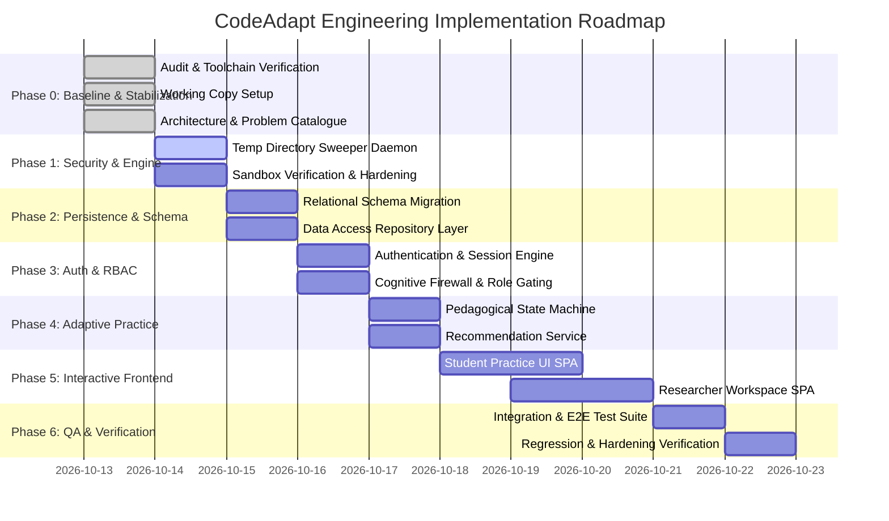

# CodeAdapt Implementation & Modernization Plan

## 1. Executive Summary & Strategy

This implementation plan outlines the engineering steps required to turn **CodeAdapt** from a Windows-only research prototype into a complete, working, end-to-end adaptive coding-practice website.

The plan strictly adheres to the project's non-negotiable working rules:
- **Inspect before modifying:** All source components, tests, and research artifacts have been audited and baseline outcomes recorded.
- **Incremental development:** Improve the codebase incrementally without unnecessary ground-up rewrites.
- **Architectural separation:** Maintain clear separation between the execution engine, the diagnostic/pedagogical instrument, and the application/presentation layer.
- **Research integrity:** Never alter reference fingerprints, expected outputs, synthetic fixtures, or diagnostic rules to force test suites green. Documented research divergences and construct limitations remain permanently visible.
- **No phantom functionality:** Every feature described must be fully implemented, tested, and operational, avoiding mockups.

---

## 2. Phased Roadmap Overview

---

## 3. Phase Details & Technical Work Breakdown

### Phase 0: Baseline Verification & Environment Stabilization (Completed)
- **Objective:** Establish the uncorrupted baseline, verify toolchain operations, record actual test outcomes, and set up the working copy.
- **Deliverables:**
  - Audited all 13 core files and documentation.
  - Verified GCC 16.1.0 UCRT at `C:\tools\winlibs-x86_64-posix-seh-gcc-16.1.0-mingw-w64ucrt-14.0.0-r4\mingw64\bin\g++.exe`.
  - Executed `tests/run_regression.py` and `tests/test_hardening.py`, recording empirical outcomes.
  - Created working copy `codeadapt/`, leaving original `CodeAdapt-main/` completely untouched.
  - Authored `docs/problem-catalogue.md` and `ARCHITECTURE.md`.

---

### Phase 1: Security, Sandbox & Execution Infrastructure Hardening
- **Objective:** Eliminate the temporary directory cleanup leak, enhance engine reliability, and preserve the Windows sandbox guarantees.
- **Tasks:**
  1. **Fix Temp Directory Leak in `$env:TEMP`:**
     - Replace the in-memory pending cleanup set in `backend/executor.py` with an enhanced sweeping mechanism.
     - On server startup and during periodic sweeps, scan `$env:TEMP` for any directory matching `si_sub_*`.
     - Implement bounded exponential backoff retry in `_cleanup_workdir` (with handle close verification) before falling back to the sweep queue.
     - Add startup sweep to purge orphaned folders from previous abruptly terminated processes.
  2. **Preserve Isolation Primitives:**
     - Maintain Windows Job Object flags: `ActiveProcessLimit=1`, `ProcessMemoryLimit=256MB`, `KILL_ON_JOB_CLOSE`, `DIE_ON_UNHANDLED_EXCEPTION`.
     - Maintain race-free process suspension, token lowering to Low Integrity, and directory labeling via `icacls`.
  3. **Concurrency & Resource Management:**
     - Keep semaphore-bounded submission evaluation (`MAX_CONCURRENT=4`).
     - Remap compiler diagnostics and ensure stderr stream caps remain enforced.
- **Verification Criterion:** Re-running `tests/test_hardening.py` reports `[OK] temp directory cleanup` with zero leftover directories.

---

### Phase 2: Database & Data Model Modernization
- **Objective:** Upgrade the flat SQLite database into a normalized relational schema supporting multi-tenant users, attempts, test results, diagnostic attributions, and practice recommendations.
- **Tasks:**
  1. **Schema DDL Implementation:**
     - Create database initialization module `backend/db.py` managing connections, transactions, and table creation.
     - Implement tables: `users`, `sessions`, `problems`, `submissions`, `test_results`, `diagnostic_attributions`, `practice_recommendations`, `student_practice_state`.
  2. **Migration & Data Preservation:**
     - Write migration script to import existing records from `evidence.db` without data loss.
     - Maintain verbatim JSON serialization in `submissions.record_json` to guarantee raw evidence reconstructability.
  3. **Repository Abstraction:**
     - Create clean repository methods for saving submissions, loading full execution records, logging diagnostic results, and updating student attempt histories.
- **Verification Criterion:** Database round-trip test verifying byte-identical record reconstruction and referential integrity across all tables.

---

### Phase 3: Authentication, Session Management & Role-Based Access Control
- **Objective:** Introduce secure user accounts and enforce strict role boundaries between students and researchers.
- **Tasks:**
  1. **User Identity & Password Hashing:**
     - Implement secure password hashing using standard library PBKDF2-HMAC-SHA256 (600,000 iterations) or `bcrypt`.
     - Support registration and login endpoints: `POST /api/auth/register`, `POST /api/auth/login`, `POST /api/auth/logout`, `GET /api/auth/me`.
  2. **Session Security:**
     - Implement cryptographically secure session tokens stored in HTTP-only, SameSite cookies.
     - Validate token expiration and support immediate session invalidation on logout.
  3. **Cognitive Firewall (Role Gating):**
     - Define roles: `student`, `researcher`, `admin`.
     - Gate researcher endpoints (`/api/research/*`, `/api/submissions/{id}/diagnostics`) behind researcher-role dependencies.
     - Ensure student responses never contain internal error taxonomy identifiers (e.g., `E3_upper_bound`, `wrong_order_swap`), preventing cognitive priming.
- **Verification Criterion:** Unit and integration tests verifying students receive `403 Forbidden` on researcher routes and that student practice responses contain zero researcher diagnostic labels.

---

### Phase 4: Adaptive Practice & Recommendation Service
- **Objective:** Implement the adaptive recommendation engine providing justified, student-safe guidance or cautious abstentions.
- **Tasks:**
  1. **Pedagogical State Machine (`backend/practice.py`):**
     - Map diagnostic verdicts to student-safe states:
       - `task_correct` $\rightarrow$ State: `correct`. Message clarifies that passing does not establish method mastery. Recommends curriculum progression to next concept.
       - `single_match` $\rightarrow$ State: `insufficient_evidence`. Message provides conceptual hint without revealing the bug name. Recommends retry.
       - `ambiguous` $\rightarrow$ State: `insufficient_evidence`. Message acknowledges multiple plausible explanations without guessing. Recommends targeted retry.
       - `unmodelled` $\rightarrow$ State: `insufficient_evidence`. Message notes implementation issues without concept-level claims. Recommends retry.
       - `no_execution_evidence` $\rightarrow$ State: `no_execution_evidence`. Message provides remapped compiler error details. Recommends syntax fix.
  2. **Student Practice Progression Tracker:**
     - Track student attempt history and progression across the five pilot problems.
     - Support iterative retry cycles: problem $\rightarrow$ attempt 1 $\rightarrow$ feedback $\rightarrow$ attempt 2.
- **Verification Criterion:** Contract tests verifying recommendation outputs for all synthetic error submissions across P1–P5.

---

### Phase 5: Modern Interactive Web Application (Frontend)
- **Objective:** Build an intuitive, responsive user interface supporting both the student practice loop and the researcher inspection workspace.
- **Tasks:**
  1. **Frontend Architecture:**
     - Modular, component-driven client structured into clean semantic views without complex build toolchain dependencies.
     - Modern styling with accessible design, dark/light theme support, and clear visual hierarchy.
  2. **Student Practice App:**
     - **Problem Browser:** Problem cards with concept tags, difficulty badges, and solved status.
     - **Practice Workspace:**
       - Split-pane layout with statement, constraints, and starter code.
       - Modern C++ editor with line numbers, bracket matching, and auto-indentation.
       - "Run Tests" action with live compilation and execution status indicators.
     - **Execution Evidence Drawer:**
       - Compact $P/F/R$ badge summary.
       - Per-test results table showing Test ID, role, status, expected vs actual outputs, runtime, and memory.
       - Undefined behavior alert banner when dynamic assertions trigger.
     - **Practice Follow-up Card:**
       - Educational explanation of current state.
       - Clear, actionable next-step recommendation button ("Retry with Revision" or "Practice Next Problem").
     - **Attempt History View:** Student submission timeline.
  3. **Researcher Inspection Workspace:**
     - **Overview Dashboard:** Submission volume, outcome distribution charts, compile failure rates.
     - **Evidence Explorer:** Filterable and searchable table of all historical submissions.
     - **Detailed Submission Inspector:**
       - Verbatim student code side-by-side with generated driver code.
       - Full diagnostic attribution report: observed fingerprint, candidate errors list, mismatch diffs, dynamic UB probe log, and novel bug discrimination check.
       - Raw evidence JSON viewer and export utility.
     - **Matrix Benchmark Viewer:** Problem reference matrix viewer comparing claimed vs derived vs student observed patterns.
- **Verification Criterion:** End-to-end browser walkthrough verifying submission, evidence display, recommendation presentation, and researcher inspection.

---

### Phase 6: Comprehensive Testing, Quality Assurance & Verification
- **Objective:** Validate the complete product end-to-end while ensuring no regressions in the research instrument.
- **Tasks:**
  1. **Preserve Baseline Regression & Hardening:**
     - Run `tests/run_regression.py` and verify all 23 baseline rows and infrastructure invariants pass.
     - Run `tests/test_hardening.py` and verify process limits, memory caps, write-blocking, and clean temp directory removal.
  2. **New Automated Test Suites:**
     - `tests/test_auth.py`: Registration, login, session validation, logout, and password hashing.
     - `tests/test_api_student.py`: Problem listing, submission execution, evidence retrieval, practice recommendation contract.
     - `tests/test_api_researcher.py`: Access control, evidence explorer, diagnostic inspection, and data export.
     - `tests/test_practice_engine.py`: Pedagogical state transitions across all diagnostic outcomes.
  3. **End-to-End Acceptance Tests:**
     - Automated workflow testing a complete student practice session from account creation to problem completion.
- **Verification Criterion:** All regression, hardening, unit, and integration tests exit code 0 (excluding accepted research divergences).

---

### Phase 7: Operational Documentation & Showcase Readiness
- **Objective:** Provide clear operational scripts and documentation for running, testing, and presenting the platform.
- **Tasks:**
  1. **Operational Scripts:**
     - `1-SETUP.bat`: Python virtual environment and dependency installer.
     - `2-START.bat`: Server launcher configured with verified toolchain and environment variables.
     - `RUN-TESTS.bat`: One-click execution of regression and hardening suites.
  2. **Documentation Updates:**
     - Updated `README.md` reflecting the new user accounts, student practice flow, and researcher workspace.
     - Showcase demonstration script detailing the controlled pilot workflow.

---

## 4. Work Breakdown Structure (WBS) & Milestones

| Milestone | Deliverables | Target Exit Gate |
|---|---|---|
| **M0: Audit & Architecture** | `docs/problem-catalogue.md`, `ARCHITECTURE.md`, `IMPLEMENTATION_PLAN.md`, working copy setup. | Baseline verified; plans approved. |
| **M1: Engine Hardening** | Fixed temp sweeper daemon, verified sandbox cleanup. | `test_hardening.py` cleanup check passes. |
| **M2: Data & Auth Tier** | Relational schema, repository layer, session & RBAC engine. | Unit tests for DB and Auth pass. |
| **M3: Practice Engine** | Pedagogical state machine, student recommendation service. | Practice contract tests pass across P1–P5. |
| **M4: Interactive Web UI** | Student Practice SPA, Researcher Workspace SPA. | Complete UI operational in browser. |
| **M5: Full Verification** | End-to-end integration tests, regression suite check, hardening check. | Zero infrastructure failures. |
| **M6: Showcase Ready** | Launchers, user manuals, demonstration runbook. | Ready for end-to-end demonstration. |

---

## 5. Risk Assessment & Mitigation Strategies

| Identified Risk | Impact | Likelihood | Mitigation Strategy |
|---|---|---|---|
| **Windows Temp File Locking** | Temp cleanup leaks if terminated executables retain file locks. | Medium | Implement startup sweep and exponential backoff retry in `_cleanup_workdir`. |
| **Undefined Behavior Sensitivity** | Compiler optimization shifts outcomes for code with UB. | High | Pinned `SI_OPT=-O1`, `-D_GLIBCXX_ASSERTIONS` dynamic probe, static cell exclusions in `UB_DEPENDENT_CELLS`. |
| **External Filesystem Read** | Low-Integrity processes can read host files due to DACLs. | High (Inherent) | Document as accepted limitation; enforce local network deployment; plan AppContainer isolation for production. |
| **Student Cognitive Priming** | Students exposed to error labels game the instrument. | High | Implement strict API-level cognitive firewall hiding research labels from student responses. |
| **Linear Scan Bypass on P5** | Passing P5 does not prove binary search reasoning. | High (Inherent) | Documented permanent limitation; platform explicitly reports "task correctness only, does not establish binary search method". |
