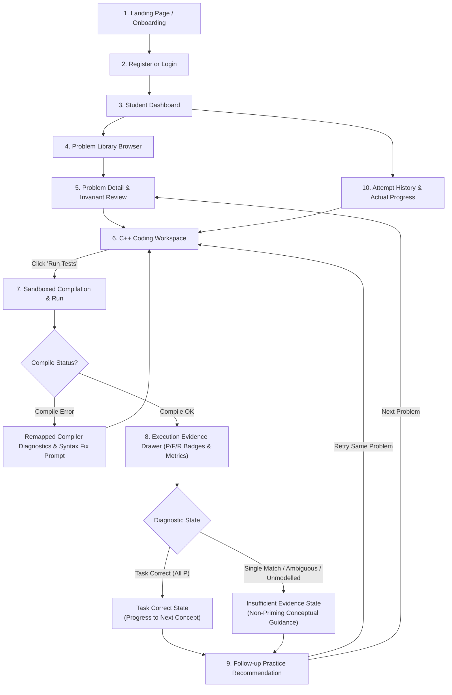
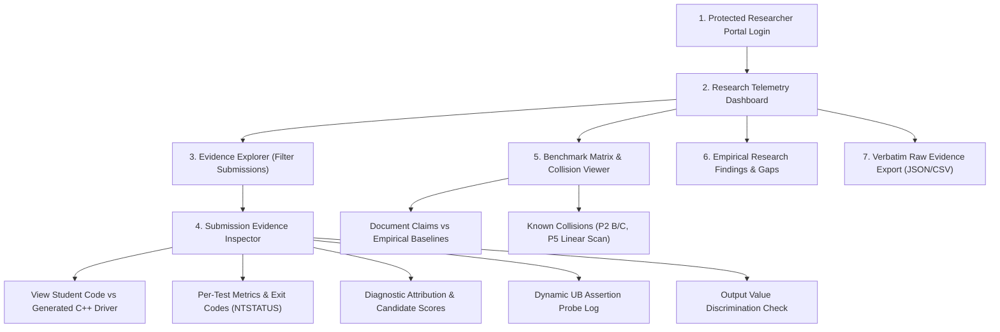

# CodeAdapt User Flows & Experience Design Specification

This document details the user experience architecture, screen layouts, interaction models, and decision flows for both the **Student Area** and the **Researcher Area** in CodeAdapt.

---

## 1. User Experience Overview

CodeAdapt provides two purpose-built, role-gated environments:
1. **The Student Learning & Practice Area:** A distraction-free, pedagogically guided environment where students practice fundamental C++ concepts (Arrays, Linked Lists, Stacks, Queues, Binary Search), receive transparent execution evidence, and get targeted, non-priming practice follow-ups.
2. **The Researcher Inspection Workspace:** A high-fidelity research environment where CS education researchers and instructors inspect raw execution traces, examine diagnostic decision trees, analyze undefined behavior assertion probes, and evaluate cohort-level error distributions without obscuring ambiguity or construct limitations.

```
+---------------------------------------------------------------------------------------+
|                                    CodeAdapt Platform                                 |
+-------------------------------------------+-------------------------------------------+
|               Student Area                |              Researcher Area              |
+-------------------------------------------+-------------------------------------------+
| 1. Landing & Onboarding                   | 1. Protected Researcher Portal            |
| 2. Registration & Authentication          | 2. Telemetry & Experiment Dashboard       |
| 3. Student Dashboard & Concept Map        | 3. Submission & Test Evidence Explorer    |
| 4. Searchable Problem Library             | 4. Diagnostic Decision Trace Inspector    |
| 5. C++ Coding Workspace                   | 5. Benchmark Matrix & Collision Viewer    |
| 6. Execution Results & Evidence Drawer    | 6. Abstention & Ambiguity Reports         |
| 7. Diagnostic Explanation / Abstention    | 7. Empirical Research Findings            |
| 8. Recommended Follow-up Practice         | 8. Verbatim Raw Evidence Export (JSON)    |
| 9. Attempt History & Actual Progress      |                                           |
+-------------------------------------------+-------------------------------------------+
```

---

## 2. Student User Flows



---

### Flow S1: Landing Page & Onboarding
- **URL / View:** `#/` or `#/onboarding`
- **Objective:** Introduce the student to the platform's execution-grounded approach to learning C++.
- **Key Elements:**
  - **Hero Banner:** "Master C++ Data Structures Through Execution Evidence." Clear subtitle explaining that CodeAdapt tests code against rich behavioral suites to help students uncover edge cases and algorithmic misconceptions.
  - **The 5 Pilot Concepts:** Visual overview cards of Arrays (Move Zeroes), Linked Lists (Reverse List), Stacks (Valid Parentheses), Queues (Round Robin Scheduling), and Binary Search (Lower Bound).
  - **Transparent Evaluation Philosophy:** Explains what $P$, $F$, and $R$ mean:
    - `P` (Passed / Correct output)
    - `F` (Ran to completion but produced incorrect output)
    - `R` (Runtime crash, timeout / infinite loop, or memory exceeded)
    - Compile errors are treated as a separate category, never penalizing algorithmic correctness.
  - **Action Controls:** "Get Started" (leads to `#/register`) and "Sign In" (leads to `#/login`).

---

### Flow S2: Registration & Login
- **URL / View:** `#/register` and `#/login`
- **Objective:** Secure account creation and authentication.
- **Key Elements:**
  - Minimalist, accessible form fields: Username, Email, Password, Password Confirmation.
  - Clear validation feedback (inline error on duplicate username, mismatched password, or weak length).
  - Role Assignment: By default, accounts register as `student`. An option to toggle/request `researcher` role is available for demonstration and evaluation purposes.
  - Success Behavior: Upon successful registration/login, a secure HTTP-only session cookie is set, and the student is routed to `#/dashboard`.

---

### Flow S3: Student Dashboard & Concept Overview
- **URL / View:** `#/dashboard`
- **Objective:** Provide a centralized view of the student's learning progress based strictly on actual stored execution data.
- **Key Elements:**
  - **Welcome Card:** Greeting with current username and role badge.
  - **Real Progress Metrics:**
    - Problems Solved (e.g., $3 / 5$).
    - Total Submissions Made.
    - Active Concept Focus.
  - **Concept Mastery Cards:** Grid of the 5 core concepts with status indicators (`Not Started`, `In Progress`, `Completed`).
  - **Recent Attempts Widget:** Displays the last 3 submissions with timestamp, problem title, compact fingerprint badge (e.g., `PPPPPPPP`), and a "Resume Problem" button.
  - **Quick Action:** "Browse All Problems" button leading to `#/problems`.

---

### Flow S4: Searchable Problem Library
- **URL / View:** `#/problems`
- **Objective:** Enable students to find, filter, and choose practice problems.
- **Key Elements:**
  - **Search Bar:** Real-time text filter searching across problem title, concept, and keywords.
  - **Concept Filter Pills:** `All`, `Arrays`, `Linked Lists`, `Stacks`, `Queues`, `Binary Search`.
  - **Status Filter:** `All`, `Solved`, `Unsolved`, `Attempted`.
  - **Problem Grid / Table:**
    - Problem ID (e.g., `PILOT-001`).
    - Problem Title (e.g., `Move Zeroes`).
    - Primary Concept.
    - Difficulty Badge (`Easy`, `Easy-Medium`, `Medium`).
    - Test Suite Size (e.g., `9 diagnostic tests`).
    - Status Badge (Green checkmark for solved, amber dot for attempted).
    - "Solve Challenge" / "Practice" button.

---

### Flow S5: Problem Detail & Invariant Review
- **URL / View:** `#/problems/:id`
- **Objective:** Present requirements, mathematical constraints, and data structure signatures before coding.
- **Key Elements:**
  - **Header:** Problem Title, Problem ID, Concept, Difficulty badge.
  - **Description Panel:** Formatted Markdown problem statement.
  - **Function Signature Box:** Highlighting the required C++ signature (e.g., `int lowerBound(const std::vector<int>& arr, int target);`).
  - **Provided Data Structures:** When applicable (e.g., `ListNode` for P2), displays the exact platform-provided struct definition.
  - **Formal Constraints List:** Bulleted constraints (e.g., array length up to $10^5$, numerical ranges).
  - **Concrete Examples:** Formatted sample inputs with expected return values or array states.
  - **Educational Invariant Note:** Highlighting key algorithmic properties without priming specific bugs.

---

### Flow S6: C++ Coding Workspace
- **URL / View:** `#/problems/:id` (integrated split-view or full-height tab)
- **Objective:** Author C++ code with modern editor ergonomics and submit to the execution sandbox.
- **Key Elements:**
  - **Split-Pane Layout:**
    - Left Pane: Problem specification, constraints, examples.
    - Right Pane: Code editor, action toolbar, and live results drawer.
  - **C++ Code Editor:**
    - Starter code pre-loaded for the selected problem.
    - Line numbering, C++ syntax highlighting, matching bracket assistance, tab indentation ($4$ spaces), and monospace font (Cascadia Code / Consolas).
  - **Editor Action Toolbar:**
    - "Run Tests" button (Primary action; disabled while running).
    - "Reset to Starter Code" button (with confirmation dialog).
    - "Clear Results" button.
    - Keyboard shortcut support (`Ctrl+Enter` to run tests).
  - **Active State Indicator:** Displays "Compiling submission..." and "Executing sandboxed test processes..." with a clean loading spinner while the backend executes.

---

### Flow S7: Compilation Error Handling
- **Trigger:** Submission fails to compile (`compile_status != 'OK'`).
- **Pedagogical Design:**
  - Compilation errors are treated as a distinct outcome, never mapped to wrong answer (`F`) or runtime failure (`R`). Zero test rows are executed.
  - **Remapped Line Numbers:** GCC errors referencing generated harness files (e.g., `tmp/submission.cpp:42:15: error: ...`) are dynamically remapped so line numbers match the student's exact editor lines. Internal platform driver lines are stripped to prevent student confusion.
  - Clear syntax error banner with actionable guidance: "Your code could not be compiled. Please fix the compiler errors below and retry."

---

### Flow S8: Execution Evidence Drawer
- **Trigger:** Submission compiles successfully (`compile_status == 'OK'`).
- **Objective:** Surface transparent, per-test execution evidence without reducing it to an opaque grade.
- **Key Elements:**
  - **Fingerprint Bar:** Prominent visual row of compact badges:
    - Green `P` (Correct output)
    - Orange `F` (Wrong output)
    - Red `R` (Crash, timeout after 3s, or memory limit exceeded)
  - **Summary Metrics:** Total tests passed (e.g., $6 / 8$), total execution time (ms), and peak memory (KB).
  - **Per-Test Detailed Evidence Table:**
    - **Test Column:** Test ID (e.g., `T1`, `T4`) and diagnostic role (`Core`, `Boundary`, `Behavioral Diagnostic`, `Control`, `Robustness`).
    - **Outcome Column:** Status badge (`P`, `F`, `R`), with descriptive crash/timeout details if applicable (e.g., `wall-clock timeout after 3.0s (non-termination)` or `ACCESS_VIOLATION 0xC0000005`).
    - **Expected vs Actual Column:** Monospace display comparing expected return values with actual student return values. For Linked Lists, displays reachable values, cycle status, and termination status.
    - **Resource Column:** Individual wall-clock execution time and peak memory consumption.
  - **Undefined Behavior Warning Banner:**
    - If the dynamic `-D_GLIBCXX_ASSERTIONS` probe detected a precondition violation (e.g., vector out of bounds or empty stack access), a distinct alert banner explains that undefined behavior occurred on marked tests, noting that results on those tests are sensitive to compiler memory layout.

---

### Flow S9: Pedagogical Diagnostic Guidance & Insufficient-Evidence States
- **Objective:** Deliver justified pedagogical feedback derived from the diagnostic engine while enforcing the **Cognitive Firewall** (never priming students with researcher bug labels).
- **State 1: Task Correct (`task_correct` / All `P`)**
  - **Banner:** Green checkmark.
  - **Message:** "Your solution produced the expected results on all tested cases. Note: passing the test suite confirms task correctness on these cases, but does not establish concept mastery or that a specific algorithmic method was used (for example, linear search can pass lower bound)."
  - **Action:** Prompts the student to proceed to the next problem in the curriculum.
- **State 2: Insufficient Evidence / Single Match (`single_match`)**
  - **Banner:** Information banner.
  - **Message:** "Your results are consistent with one supported pattern, but this is not proof of the underlying cause. Review your boundary conditions, loop termination, and interval updates." *(Crucial: Does NOT say "You have Error E3: Upper Bound Confusion" to avoid cognitive priming).*
  - **Action:** Prompts the student to retry the current problem with invariant guidance.
- **State 3: Insufficient Evidence / Ambiguous or Unmodeled (`ambiguous` / `unmodelled`)**
  - **Banner:** Amber caution banner.
  - **Message:** "Insufficient evidence for a single supported diagnosis. The observed test failures do not justify choosing one specific explanation. Re-examine how your solution handles edge cases and the required invariants."
  - **Action:** Prompts the student to re-trace failing test cases and retry.

---

### Flow S10: Recommended Follow-Up Practice
- **Objective:** Guide the student to their next learning step without forcing arbitrary paths.
- **Key Elements:**
  - Embedded recommendation card at the base of the results drawer.
  - **Action Type:** `retry` (revise current problem) or `practice` (advance to next problem).
  - **Target Problem Card:** Displays the recommended problem title, concept, difficulty, and the pedagogical reason.
  - **One-Click Navigation:** "Start Follow-up Practice" button navigates directly to the target problem with attempt chaining enabled.

---

### Flow S11: Attempt History & Attempt Chaining
- **URL / View:** `#/history`
- **Objective:** Allow students to review their historical submissions, inspect past fingerprints, and observe their progression over time.
- **Key Elements:**
  - **Chronological Timeline:** Every historical submission logged with date, problem title, fingerprint badges, and compile status.
  - **Attempt Chaining (`Attempt #1` $\rightarrow$ `Attempt #2`):** Links related attempts together, allowing students to compare their revised code side-by-side with their previous attempt.
  - **"Load Code" Button:** Loads the exact code from a historical attempt back into the editor.

---

### Flow S12: Student Profile & Logout
- **URL / View:** `#/profile`
- **Objective:** Manage account details, theme preferences, and secure logout.
- **Key Elements:**
  - Username, email, account creation date, assigned role.
  - Theme preference toggle (`Dark Developer Workspace` vs `Light Learning Interface`).
  - "Log Out" button invalidating the session cookie and redirecting to `#/login`.

---

## 3. Researcher User Flows



---

### Flow R1: Protected Researcher Authentication
- **Access Control:** All researcher routes (`#/research/*`) and APIs (`/api/research/*`) are strictly guarded on the backend. Attempting to access without `role == 'researcher'` or `role == 'admin'` returns `403 Forbidden` and redirects to an unauthorized access notice.
- **UI Indicator:** Distinctive "Researcher Workspace" purple banner badge in the top navigation header distinguishes the research environment from the student practice interface.

---

### Flow R2: Research Telemetry & Cohort Dashboard
- **URL / View:** `#/research/dashboard`
- **Objective:** High-level statistical overview of platform usage, submission volume, and diagnostic verdict distributions based on actual stored database records.
- **Key Elements:**
  - **Cohort Metric Cards:**
    - Total Submissions Evaluated.
    - Unique Students.
    - Overall Compilation Error Rate.
    - Distribution of Diagnostic Verdicts:
      - `task_correct` count & percentage.
      - `single_match` count & percentage.
      - `ambiguous` (collision) count & percentage.
      - `unmodelled` count & percentage.
      - `no_execution_evidence` count & percentage.
  - **Problem Breakdown Table:** For each pilot problem (P1–P5), shows total attempts, unique solvers, most frequent failure fingerprints, and undefined behavior encounter rates.
  - **Toolchain Integrity Badge:** Displays the active compiler version (e.g., `GCC 16.1.0 UCRT`), optimization level (`-O1`), language standard (`c++17`), and instrument hash.

---

### Flow R3: Evidence Explorer
- **URL / View:** `#/research/evidence`
- **Objective:** Search, filter, and inspect all student submissions across cohorts.
- **Key Elements:**
  - **Multi-Parameter Filter Toolbar:**
    - Problem selector (`PILOT-001` through `PILOT-005`).
    - Verdict filter (`task_correct`, `single_match`, `ambiguous`, `unmodelled`, `compile_error`).
    - Fingerprint search (e.g., filter for `RRRFRRRR` or `FPFFFFFF`).
    - Date range picker.
    - Student ID / Username search.
  - **Submissions Data Table:**
    - Submission ID (truncated hex with copy-to-clipboard).
    - Timestamp.
    - Student Identifier.
    - Problem ID & Title.
    - Compile Status.
    - Fingerprint Badges (compact $P/F/R$ visual).
    - Diagnostic Verdict Badge.
    - Undefined Behavior Detected (`Clean` vs `Violation`).
    - Action: "Inspect Evidence" button opening Flow R4.

---

### Flow R4: Diagnostic Decision Trace & Evidence Inspector
- **URL / View:** `#/research/evidence/:id`
- **Objective:** Complete, unreduced inspection of a single submission, showing both observed facts and diagnostic inferences.
- **Panel 1: Source Code & Generated Translation Unit**
  - Side-by-side or tabbed view showing:
    1. Student Source Code (verbatim as submitted).
    2. Full Generated C++ Driver Code (showing platform prologue, driver skeleton, switch-case test inputs, and result file writing).
    3. Remapped Compiler Diagnostics (raw stderr and remapped lines).
- **Panel 2: Full Test-Level Execution Trace**
  - Complete data table for every test case:
    - Test ID & Research Metadata (Role, Diagnostic Target, Confidence, Informativeness, Potential Confound).
    - Status (`P`, `F`, `R`) & Detailed Execution Status (`COMPLETED`, `TIMEOUT`, `CRASHED`, `NO_RESULT`, `PARSE_ERROR`).
    - Expected Output vs Actual Output (verbatim formatted).
    - Exit Code / NTSTATUS (e.g., `0xC0000005 ACCESS_VIOLATION`, `0xC0000409 STACK_BUFFER_OVERRUN`, `0xC00000FD STACK_OVERFLOW`).
    - Integrity Level (`low` vs `medium`).
    - Wall Time (ms) & Peak Memory (bytes).
    - Raw Standard Output text.
    - Standard Error snippet.
- **Panel 3: Diagnostic Attribution Trace & Candidate Matcher**
  - **Observed Fingerprint vs Reference Matrices:** Visual diff comparing the observed row against all candidate reference errors for that problem.
  - **Candidate Error Scoring Table:**
    - Modeled Error Name (e.g., `E3_upper_bound`).
    - Description of Defect.
    - Reference Fingerprint.
    - Number of Cells Compared (accounting for UB exclusions).
    - Mismatched Test IDs.
    - Exact Match Flag (`Yes` / `No`).
  - **Verdict Summary:** Formatted statement explaining why the decision was rendered:
    - If `single_match`: names candidate error and explicitly adds caution that a different bug could produce an identical row.
    - If `ambiguous`: lists colliding error classes and explains lack of separability.
    - If `unmodelled`: lists nearest candidate and differing tests.
- **Panel 4: Dynamic Undefined Behavior Assertion Probe Log**
  - Displays results of the secondary `-D_GLIBCXX_ASSERTIONS` build:
    - Static UB Exclusions for this problem/error.
    - Dynamic Probe Result per test: `clean`, `violation`, `timeout`, or `crash`.
    - Violated Precondition String extracted from libstdc++ assertion (e.g., `__n < this->size()`).
- **Panel 5: Output Value Discrimination Check**
  - For submissions matching P5/E3 (`FPPPFFPF`), highlights whether returned values match reference upper-bound outputs or correspond to novel bugs (e.g., returning $n$ whenever target is found).

---

### Flow R5: Benchmark Matrix & Collision Viewer
- **URL / View:** `#/research/matrices`
- **Objective:** Benchmark reference matrices, document claims, and known theoretical/empirical collisions.
- **Key Elements:**
  - **Problem Selector:** P1 through P5 tabs.
  - **Matrix Comparison Grid:**
    - Lists every modeled error class.
    - Shows Document Claimed Fingerprint vs Empirically Derived Baseline Fingerprint vs Active Student Frequencies.
    - Flags known divergences (e.g., P3/E2 T4 `R` vs `F`, P5/E2 T4 `F` vs `R`).
  - **Documented Collision Tables:**
    - P2: Explains why Error B (wrong return variable) and Error C (off-by-one loop bound) collide identically (`FPFFFFFF`).
    - P5: Explains the linear scan construct-validity bypass (`PPPPPPPP`).
  - **Undefined Behavior Cell Registry:** Lists all statically declared UB cells and their empirical verification status.

---

### Flow R6: Empirical Research Findings & Export
- **URL / View:** `#/research/findings` and `#/research/export`
- **Objective:** Review verified platform findings and export raw evidence records.
- **Key Elements:**
  - **Findings Overview:** Interactive presentation of verified findings from `FINDINGS.md` (isolation boundaries, toolchain stability, UB measurement).
  - **Export Options:**
    - Export Full Dataset as JSON (verbatim execution records including generated source and raw outputs).
    - Export Summary Table as CSV (submission metadata, fingerprints, verdicts, runtimes, and memory peaks).
    - Filter export by problem, date, or cohort.

---

## 4. Design Direction & Interface Aesthetics

### 4.1 Design Philosophy: Coherent Developer Education
CodeAdapt balances two critical design requirements:
1. **Developer Workspace Efficiency:** A dark-mode optimized, distraction-free code editing environment designed for reading C++ syntax and dense diagnostic tables without eye strain.
2. **Pedagogical Clarity:** Accessible, structured presentation of feedback using clear contrast, human-friendly typography, and distinct status color tokens.

### 4.2 Visual System & Color Tokens

```css
:root {
  /* Surface & Canvas (Light Learning Mode) */
  --bg-primary: #f8fafc;
  --bg-surface: #ffffff;
  --bg-subtle: #f1f5f9;
  --border-subtle: #e2e8f0;
  --border-strong: #cbd5e1;
  
  /* Typography */
  --text-primary: #0f172a;
  --text-secondary: #475569;
  --text-muted: #94a3b8;
  
  /* Brand & Navigation */
  --accent-primary: #2563eb;
  --accent-hover: #1d4ed8;
  --accent-subtle: #eff6ff;
  --researcher-accent: #7c3aed;
  --researcher-subtle: #f5f3ff;
  
  /* Execution Status Tokens (P / F / R / Compile) */
  --status-p: #16a34a;        /* Pass / Correct */
  --status-p-bg: #dcfce7;
  --status-f: #ea580c;        /* Ran but Wrong Answer */
  --status-f-bg: #ffedd5;
  --status-r: #dc2626;        /* Runtime Crash / Timeout */
  --status-r-bg: #fee2e2;
  --status-ce: #9333ea;       /* Compilation Error */
  --status-ce-bg: #f3e8ff;
}

[data-theme="dark"] {
  /* Surface & Canvas (Dark Developer Workspace) */
  --bg-primary: #0b0f19;
  --bg-surface: #111827;
  --bg-subtle: #1f2937;
  --border-subtle: #374151;
  --border-strong: #4b5563;
  
  /* Typography */
  --text-primary: #f8fafc;
  --text-secondary: #94a3b8;
  --text-muted: #64748b;
  
  /* Brand */
  --accent-primary: #3b82f6;
  --accent-hover: #60a5fa;
  --accent-subtle: #1e293b;
  --researcher-accent: #a855f7;
  --researcher-subtle: #2e1065;
  
  /* Execution Status Tokens */
  --status-p: #4ade80;
  --status-p-bg: #14532d;
  --status-f: #fb923c;
  --status-f-bg: #7c2d12;
  --status-r: #f87171;
  --status-r-bg: #7f1d1d;
  --status-ce: #c084fc;
  --status-ce-bg: #581c87;
}
```

### 4.3 Typography & Component Ergonomics
- **UI Font Family:** `Inter`, system-ui, `-apple-system`, `Segoe UI`, `Roboto`, sans-serif.
- **Code & Diagnostics Font Family:** `Cascadia Code`, `Fira Code`, `Consolas`, `ui-monospace`, monospace.
- **Interactive Feedback:** Hover transitions ($150\text{ms}$ ease), active button scaling, disabled button opacity ($50\%$), and clear focus rings (`outline: 2px solid var(--accent-primary)`).
- **Responsive Adaptability:**
  - Desktop ($> 1100\text{px}$): Dual-pane side-by-side workspace (problem on left, editor & results on right).
  - Tablet / Laptop ($768\text{px} - 1100\text{px}$): Responsive split layout with collapsible problem pane.
  - Mobile ($< 768\text{px}$): Tabbed single-column view (Tab 1: Problem, Tab 2: Code Editor, Tab 3: Execution Evidence).
